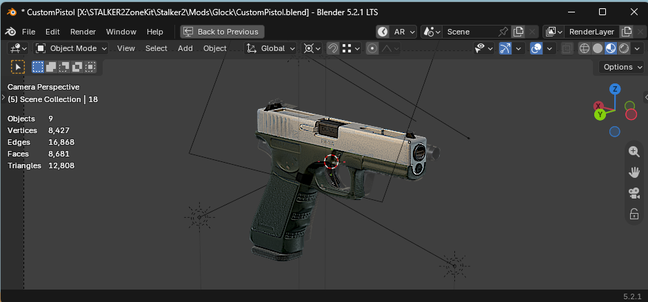

# Custom Pistol (WIP)

A work-in-progress custom pistol mod for STALKER 2: Heart of Chornobyl.

## Current Status

The weapon is currently under active development.

Current goals:

- Functional standalone weapon
- Custom meshes
- Custom textures
- Inventory icon integration
- Localisation support
- Upgrade support
- Attachment support

## Development Goals

This project also acts as a testbed for understanding the custom weapon pipeline in the STALKER 2 ZoneKit.

## Structure

Content/GameLite/ModGameData/Glock/
- Weapon prototypes
- Attachment prototypes
- Weapon settings
- Weapon attributes

Content/_Stalker_2/weapons/pistol/p_glock/
- Meshes
- Materials
- Textures

## Requirements

- STALKER 2 ZoneKit
